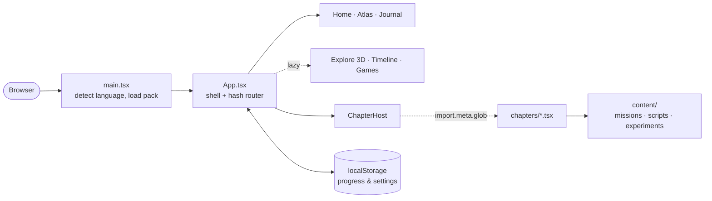

# ECHOES — The Machines That Changed Our Universe

*Their signals may fade. Their discoveries never will.*

ECHOES is an interactive space museum for curious minds, mainly ages 10–15. Visitors follow four NASA spacecraft through photo-led story chapters, solve a small science experiment in each, explore a 3D solar system, scroll a mission timeline, play three games and collect discoveries and patches in a journal.

It is a static web app that runs entirely in the browser: no backend, no accounts, no API keys and no runtime network requests of its own. All photos, planet maps and fonts ship with the site. It is available in 10 languages.

> ECHOES is an independent educational project. It is not affiliated with or endorsed by NASA.

## Contents

- [Features](#features)
- [Tech stack](#tech-stack)
- [Project structure](#project-structure)
- [Architecture](#architecture)
- [Getting started](#getting-started)
- [Environment configuration](#environment-configuration)
- [Development](#development)
- [Limitations](#limitations)
- [Content, credits and sources](#content-credits-and-sources)
- [License](#license)

## Features

| Feature | Route | What it does |
| --- | --- | --- |
| Home | `#/` | "Send a signal" hero (pulse to the Moon, Mars or Voyager 1 using real light-travel times), mission reel, wayfinding |
| Mission explorer | `#/atlas` | One mission at a time: journey, milestones with sources, photo hotspots on real hardware |
| Story chapters | `#/chapter/apollo11` · `opportunity` · `insight` · `voyager` | Photo-led scenes ending in an experiment that must be solved to continue (see below) |
| 3D solar system | `#/explore` | Sun, eight planets and the Moon in three.js with NASA surface maps and markers at nine real landing sites. A text planet guide is always available and replaces the scene without WebGL |
| Timeline | `#/timeline` | 1969–2026, mission filters, keyboard navigation |
| Games | `#/games`, `#/games/lander` · `probe` · `quiz` | Moon/Mars landing challenge, space-probe builder, 10-question photo quiz |
| Discovery journal | `#/journal` | Collected discoveries (3 core + Voyager epilogue), 9 patches, points, best scores, reset with confirmation |

Any other address shows a recovery page with links back into the museum.

| Chapter | Experiment |
| --- | --- |
| Apollo 11 | Aim at the reflector, fire laser pulses, choose `distance = c × t ÷ 2` |
| Opportunity | Sort rock samples as water evidence, then see how dust cuts the rover's sunlight |
| InSight | Find the marsquake in synthetic seismograms, read the P–S wave gap, pick the interior layer |
| Voyager 1 (epilogue) | Match spacecraft to their status; explore the heliosphere, Golden Record and power budget |

Simplified models and synthetic signals are labelled on screen.

**Accessibility.** A header panel offers high contrast, text size 100/125/150 %, reduced motion (also honoured from the OS setting) and relaxed games (more fuel, a wider pad and slow motion in the lander). Every visual has a list or button equivalent, drag and drop has tap and keyboard alternatives, focus moves to the main content on route change, status is never shown by colour alone, and nothing requires audio.

**Languages.** Kazakh, Russian, English, Spanish, Arabic (right-to-left), French, German, Hindi, Portuguese and Turkish. On a first visit the site follows the browser language, falling back to English; the choice is remembered.

## Tech stack

| Area | Technology |
| --- | --- |
| Language | TypeScript 5.9 (strict) |
| UI | React 19 (hooks, `lazy`/`Suspense`) |
| 3D | three.js 0.170 (`src/components/explore/scene.ts` only) |
| Build | Vite 7 |
| Styling | Plain CSS with custom properties |
| Fonts | Self-hosted via Fontsource |
| Tests | Vitest 3 + Testing Library (jsdom), Playwright 1.65 (Chromium) |
| Lint | ESLint 9 + typescript-eslint |
| CI / hosting | GitHub Actions → GitHub Pages |

There are no runtime dependencies besides React, three.js and the font packages.

## Project structure

```text
src/
  main.tsx, App.tsx   Boot (language detection) and shell: header, navigation, route switch, error boundary
  app/                Hash router, ChapterHost, state stores, shell data (photos, exhibits, planets, timeline)
                      and its translations (app/locales/)
  chapters/           The four chapter modules and their shared frame (chapters/shared/)
  content/            Story content, NASA sources, pure experiment logic, integrity checks, story translations
  components/         Pages and UI parts; explore/ holds the 3D solar system
  games/              Games hub, lander, probe builder, quiz
  i18n/               Locale detection, UI dictionaries (messages/), lazy language packs (packs/)
  styles/             Design tokens (global.css) and accessibility rules (a11y.css)
public/               NASA photographs (media/, full size + 640 px "-sm") and planet maps (textures/)
e2e/                  Playwright specs (*.e2e.ts) and the visual baseline (__screenshots__/)
docs/                 Science source matrix and content review
.github/workflows/    deploy.yml: lint, unit tests, build, publish to GitHub Pages
```

## Architecture



- **Routing.** A ~30-line hash router (`src/app/navigation.ts`) turns `#/…` into a typed route, so the site works on any static host and survives refresh and deep links. On each route change the shell sets the page title, moves focus to `<main>` and resets the page's error boundary.
- **Code splitting.** Home, Atlas, Journal and the English and Russian texts are in the main chunk. The 3D scene (loaded only if WebGL is available), timeline, each game, each chapter and each other language pack are separate lazy chunks.
- **Chapter contract.** `ChapterHost` discovers chapters with `import.meta.glob('../chapters/*.tsx')`. Each file is named after its ID and default-exports a component that receives only `onComplete()` (call once, after the experiment is solved) and `onBack()`. Chapters never touch `localStorage`, `location.hash` or `history`; the shell ignores duplicate completions, records the discovery and opens the journal. Missing, failed or crashing chapters show retry/return states and award nothing.
- **Content.** English data in `src/content/` and `src/app/` is the source of truth for IDs, numbers and correct answers. Experiment rules are pure functions in `src/content/experiments.ts`, shared by the chapters, the tests and the integrity runner.
- **State.** No state library: small module-level stores read through `useSyncExternalStore`, each saving one versioned JSON record. Records are validated on read (unknown IDs, duplicates and malformed data fall back to defaults), sync across tabs where relevant, and stay in memory if storage is blocked. Accessibility and contrast settings are mirrored onto `<html>` attributes that the CSS reads.

  | `localStorage` key | Module | Contents |
  | --- | --- | --- |
  | `echoes.discovery-journal.v1` | `app/progress.ts` | `{ "version": 1, "completed": ["apollo11", …] }` |
  | `echoes.explorer-log.v1` | `app/explorer.ts` | Patches, visited planets, inspected hardware, timeline moments, probes, best scores |
  | `echoes.a11y.v1` | `app/a11y.ts` | Text size, reduced motion, relaxed games |
  | `echoes.preferences.v1` | `app/preferences.ts` | High contrast |
  | `echoes.locale.v1` | `i18n/locale.ts` | Chosen language |

  The journal's reset clears the first two keys only.
- **Internationalization.** Text is overlaid on the English data in three layers, each with its own folder per language: UI strings (`src/i18n/messages/`, read with `useT()`), story content (`src/content/locales/`, `useContent()`) and shell data such as captions, hotspots, timeline and games (`src/app/locales/`, `useShell()`). The active language lives on `<html lang dir>`, so switching re-renders everything at once.
- **Styling.** "Flight hardware archive": light *hall* pages and dark *viewing rooms* (hero, Explore, photo plates, game screens) redefine the same tokens in `src/styles/global.css`; high contrast turns everything into one black room. Chapters read a stable seven-variable theme contract (`--color-bg`, `--color-surface`, `--color-text`, `--color-muted`, `--color-accent`, `--color-mars`, `--color-border`).

There is no backend, API, database or authentication, so there is no API to document.

## Getting started

Requirements: **Node.js 20.19+ or 22.12+** (Vite 7) and npm. Node 22.18+ is needed only for the content integrity script.

```sh
npm ci
npm run dev
```

Open the "Local" URL Vite prints (normally `http://localhost:5173/`). The dev server listens on `0.0.0.0`, so the "Network" URL also works from a phone on the same network.

Production build:

```sh
npm run build     # type-check (tsc -b) and build into dist/
npm run preview   # serve dist/ locally
```

## Environment configuration

None. The app reads no environment variables and needs no `.env` file, keys or services. Build settings live in `vite.config.ts` (`base: './'` for relative asset paths).

The only variable read anywhere is `CI`, by `playwright.config.ts`: when set, `test.only` fails the run, each test gets one retry, an HTML report is written and Playwright always starts its own preview server.

## Development

### Commands

| Command | What it does |
| --- | --- |
| `npm run dev` | Vite dev server with hot reload |
| `npm run build` | Type-check and build the static site into `dist/` |
| `npm run preview` | Serve the production build |
| `npm run lint` | ESLint |
| `npm test` | Vitest unit and component tests (`npx vitest` for watch mode) |
| `npm run test:e2e` | Playwright functional specs on desktop Chrome (1280×800) and Pixel 7 |
| `npm run test:visual` | Compare screenshots with the visual baseline |
| `npm run test:visual:update` | Re-record the visual baseline after an intended design change |
| `npm run test:all` | Vitest, then every Playwright project |
| `node src/content/integrity.check.mjs` | Content integrity: every chapter completable with the reference answers, sources valid, translations complete, chapter files follow the contract |

Install a browser before the first Playwright run: `npx playwright install chromium`.

### Tests

| Suite | Status (2026-11-15) | Covers |
| --- | --- | --- |
| Vitest | 157 tests in 12 files, passing | Routing, storage (corrupt, blocked, cross-tab), chapter completion, accessibility settings, explorer log, 3D data, every experiment, content and translation completeness |
| Integrity runner | 1810 / 1810 checks | Chapters, sources, translations (including identical numbers in every language) |
| Playwright functional | 88 passed, 6 skipped by design | Every route, full chapter and game journeys, widths 360–1920 px, accessibility panel, console errors, broken images |
| Playwright visual | 46 passed | Key pages in English, Russian and high contrast, with reduced motion |

Playwright builds the production bundle into `.e2e-dist/` and serves it on port 5174. Specs select elements by role, label and text, never by CSS class, and end in `.e2e.ts` so Vitest ignores them. Unit tests sit next to the code as `*.test.ts(x)`.

### Conventions

- Shared state goes in a small store in `src/app/`; components read it through hooks. Validate everything read from storage.
- No hard-coded user-facing text: add UI strings to **all ten** `src/i18n/messages/*.ts` files (TypeScript and `npm test` report missing keys and mismatched `{placeholders}`).
- Change content in the English data first, then the matching entries by ID in every `src/content/locales/` or `src/app/locales/` file. Russian shell data lives in `SHELL_RU` (`src/app/l10n.ts`) and inline `{ en, ru }` pairs in `src/app/solar.ts`.
- To add a language: add it to `LOCALES` and `LOCALE_NAMES` in `src/i18n/locale.ts` (and `RTL` if needed), create the three translation files plus `src/i18n/packs/<lang>.ts`, register it in `PACKS` (`src/i18n/packs.ts`) and in the hard-coded list in `src/content/integrity.check.mjs`.
- New photos: two WebP files in `public/media/` (`<slug>.webp` ≤ 1600 px and `<slug>-sm.webp` at 640 px) plus a `MEDIA` entry in `src/app/media.ts` with NASA ID, credit, kind, size, alt text and caption; render with `<NasaImage>`.
- New learner-facing facts need a `SOURCES` entry (HTTPS `nasa.gov`, enforced) in `src/content/missions.ts` and a row in [`docs/SCIENCE_SOURCES.md`](docs/SCIENCE_SOURCES.md).
- Before a pull request run `npm run lint`, `npm test`, `npm run build`, the integrity script and both Playwright suites. CI runs only the first three.

### Deployment

`dist/` is a fully static site. Relative asset paths and hash routes let it run from any static host or sub-directory without rewrite rules. Cache `assets/*` long-term (file names are content-hashed) and `index.html` briefly.

GitHub Pages is automated by `.github/workflows/deploy.yml`: every push to `main` runs lint, unit tests and the build (Node 24), then publishes `dist/`. One-time setup: **Settings → Pages → Source: GitHub Actions**. The site is then served at `https://<user>.github.io/<repository>/`.

## Limitations

- **No offline support:** lazy chunks need the network on first use. After a redeploy, stale tabs show a reload prompt instead of a blank page.
- **Storage warnings:** if storage is blocked the journal warns that progress is not saved, but patches and scores are dropped silently at the end of the session.
- **Duplicated definitions:** chapter IDs are defined in both `src/app/missions.ts` and `src/content/missions.ts`, and keeping them in sync is up to you.
- **Time-sensitive facts:** Voyager's status and instrument count must be re-checked before each release (checklist in [`docs/CONTENT_REVIEW.md`](docs/CONTENT_REVIEW.md#4-factual-checkpoints-all-verified-2026-11-15)).

## Content, credits and sources

- **Science.** Every fact shown to learners maps to a NASA page in [`docs/SCIENCE_SOURCES.md`](docs/SCIENCE_SOURCES.md), using the same source IDs as `src/content/missions.ts`. [`docs/CONTENT_REVIEW.md`](docs/CONTENT_REVIEW.md) records approximations, real versus illustrative data and facts to re-check. Voyager's "active" status was last checked on 2026-11-15; it is not live telemetry.
- **Photographs** come from the [NASA Image and Video Library](https://images.nasa.gov/). Each is credited in the interface with a link to its NASA ID, and artist's concepts and mosaics are labelled.
- **Planet maps** (`public/textures/`, 2:1 equirectangular WebP): Earth — NASA Blue Marble; Moon — [NASA SVS CGI Moon Kit](https://svs.gsfc.nasa.gov/4720); Mercury — MESSENGER enhanced colour; Venus — Magellan radar via [NASA-3D-Resources](https://github.com/nasa/NASA-3D-Resources); Jupiter — Cassini map [PIA07782](https://science.nasa.gov/photojournal/cassinis-best-maps-of-jupiter-cylindrical-map); Mars, Saturn, Neptune — [NASA 3D Resources](https://science.nasa.gov/3d-resources/). The Sun, Uranus and Saturn's rings are procedural, and the panels say so.
- **Diagrams, sprites, icons, patches and the wordmark** are original SVG/CSS. Diagrams and the solar system are labelled simplified and not to scale.
- No NASA logo is used. NASA imagery is used under [NASA's media guidelines](https://www.nasa.gov/nasa-brand-center/images-and-media/), which does not imply endorsement.

## License

Original ECHOES code, text and SVG/CSS artwork are released under the MIT License. Third-party dependencies keep their own licenses. NASA images and source pages are not relicensed by this project.

MIT License

Copyright (c) 2026 ECHOES contributors

Permission is hereby granted, free of charge, to any person obtaining a copy of this software and associated documentation files (the “Software”), to deal in the Software without restriction, including without limitation the rights to use, copy, modify, merge, publish, distribute, sublicense, and/or sell copies of the Software, and to permit persons to whom the Software is furnished to do so, subject to the following conditions:

The above copyright notice and this permission notice shall be included in all copies or substantial portions of the Software.

THE SOFTWARE IS PROVIDED “AS IS”, WITHOUT WARRANTY OF ANY KIND, EXPRESS OR IMPLIED, INCLUDING BUT NOT LIMITED TO THE WARRANTIES OF MERCHANTABILITY, FITNESS FOR A PARTICULAR PURPOSE AND NONINFRINGEMENT. IN NO EVENT SHALL THE AUTHORS OR COPYRIGHT HOLDERS BE LIABLE FOR ANY CLAIM, DAMAGES OR OTHER LIABILITY, WHETHER IN AN ACTION OF CONTRACT, TORT OR OTHERWISE, ARISING FROM, OUT OF OR IN CONNECTION WITH THE SOFTWARE OR THE USE OR OTHER DEALINGS IN THE SOFTWARE.
